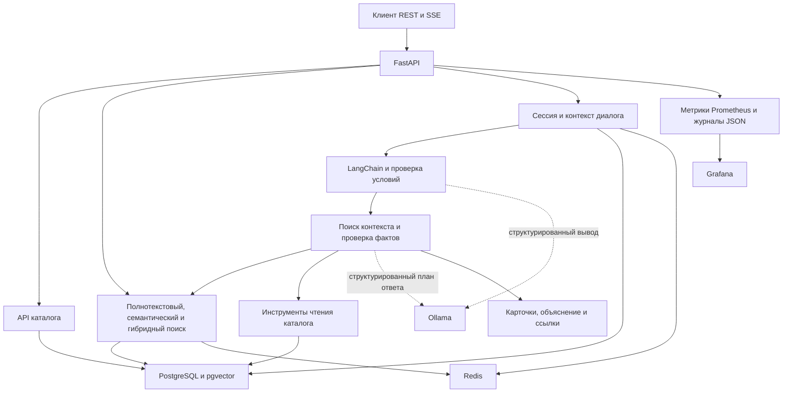

# Архитектура AI Shopping Assistant

Сервис предоставляет HTTP API каталога, поиск и консультации с памятью диалога. PostgreSQL хранит карточки, источники, векторы, историю и оценки. Redis хранит временное состояние, кэши и счётчики трафика. Ollama выполняет локальные обращения к языковой модели.

## Границы компонентов

| Путь | Ответственность |
|---|---|
| `app/modules/catalog` | Чтение и фильтры каталога, операции сопровождения данных, генератор синтетического набора |
| `app/modules/search` | HTTP-контракт, ранжирование и кэш поисковой выдачи |
| `app/modules/chat` | Проверка владельца, управление сессиями, хранение сообщений и выдача SSE |
| `app/ai` | Векторизация, извлечение требований, RAG, инструменты каталога и провайдер Ollama |
| `app/core` | Настройки, подключения, Redis, ограничения трафика и метрики |
| `app/evaluation`, `benchmarks` | Версионированные сценарии оценки и нагрузочные проверки |
| `migrations`, `infra` | Схема PostgreSQL, роли, наблюдаемость и тестовое окружение |

## Обработка сообщения

1. Chat API проверяет секрет владельца и срок сессии. Изменения одной сессии упорядочиваются блокировкой строки PostgreSQL.
2. Консультант извлекает намерение и обязательные условия. Уточнения используют структурированное состояние предыдущих ходов.
3. Поиск и инструменты применяют фильтры каталога. Гибридный маршрут объединяет позиции кандидатов по RRF.
4. RAG передаёт ограниченные выдержки и карточки в настроенную модель. Сервер сверяет выбранные товары и документы, затем сам подставляет цены, наличие и характеристики.
5. Сообщения и результаты записываются в одной транзакции. REST возвращает подтверждённый ответ, SSE отправляет его событием `result`.

Без работающей Ollama консультант использует серверные правила разбора и ответа. Доступность векторизации настраивается отдельно. [Правила RAG](rag.md) · [Поисковые стратегии](search-api.md) · [Память диалога](conversations.md).
