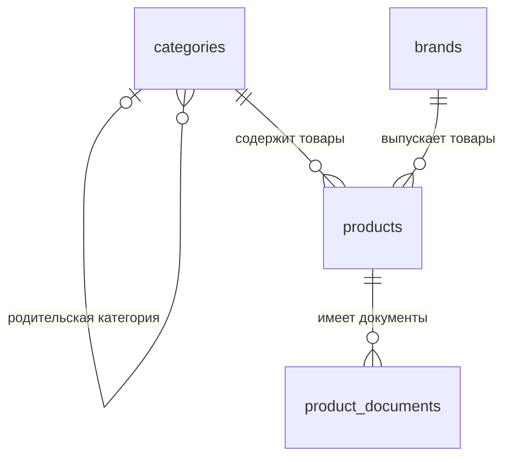

# Схема каталога

Модели SQLAlchemy и миграция Alembic `0002` описывают четыре таблицы PostgreSQL. Идентификаторы имеют тип `UUID` и генерируются в базе, если при вставке указан только набор бизнес-полей.



| Таблица | Данные и ограничения |
|---|---|
| `categories` | Название, описание, уникальный `slug` и необязательная ссылка на родителя. База отклоняет ссылку категории на саму себя. |
| `brands` | Уникальное название и описание бренда. |
| `products` | Категория, бренд, название, уникальный артикул, описание, цена, валюта, остаток, характеристики, рейтинг и признак активности. Остаток и цена неотрицательны, рейтинг при наличии находится в диапазоне от 0 до 5. |
| `product_documents` | Товар, тип, заголовок, содержимое, источник и временные метки. Поддерживаются описание товара, технические характеристики, руководство и частые вопросы. |

Цена хранится в `NUMERIC(14,2)` и представлена в Python как `Decimal`. Валюта по умолчанию — `RUB`, а схема проверяет формат трёхбуквенного кода. Временные метки хранятся в `TIMESTAMP WITH TIME ZONE`. Триггеры PostgreSQL обновляют `updated_at` у товаров и документов при записи через ORM или SQL.

Категорию или бренд с привязанными товарами можно удалить после переноса или удаления этих товаров. При удалении товара PostgreSQL удаляет его документы. B-tree-индексы покрывают поиск по родительской категории, бренду, товару для документа, диапазону цен и паре «категория, цена».

## Технические характеристики

Поле `products.specifications` хранит JSON-объект. Перечисленные числовые ключи принимают положительные числа в заданных единицах. Отсутствующая характеристика представляется отсутствием ключа.

| Ключи | Единица измерения |
|---|---|
| `ram_gb`, `ssd_gb`, `storage_gb`, `vram_gb` | ГБ |
| `display_size_in` | дюймы |
| `resolution_width_px`, `resolution_height_px` | пиксели |
| `refresh_rate_hz` | Гц |
| `battery_capacity_mah` | мА·ч |
| `camera_mp` | Мп |
| `weight_g` | граммы |
| `volume_l` | литры |
| `load_capacity_kg` | килограммы |
| `power_w` | Вт |

Числовые фильтры используют приведение значения к `numeric`. При отсутствующем ключе выражение сравнения исключает товар из результата.

```sql
SELECT id, sku, price
FROM products
WHERE is_active
  AND currency = 'RUB'
  AND price <= 80000.00
  AND (specifications ->> 'ram_gb')::numeric >= 16;
```

## Миграции и права доступа

В Compose `shopping_migrator` применяет миграции, а `shopping_app` получает `SELECT` на четыре таблицы каталога. При развёртывании вне Compose роль `shopping_app` должна существовать до применения `0002`. Для загрузки данных после миграции используйте [генератор каталога](catalog.md).

```bash
docker compose run --rm migrate alembic current
docker compose run --rm migrate alembic check
```

Откат к `0001` удаляет таблицы каталога и их данные. Расширение pgvector остаётся установленным.

## Векторные данные

Миграция `0003` добавляет `product_embeddings` и `document_chunks` с полями `VECTOR(384)`. Товар или позиция фрагмента уникальны в пределах пары `embedding_model` и `embedding_version`. Удаление товара или документа удаляет связанный вектор через внешний ключ. Роль API получает права чтения. Миграция `0004` добавляет по одному частичному HNSW-индексу на таблицу для выбранного пространства. [Генерация и версии](embeddings.md) · [Поиск и переиндексация](vector-search.md).

## Полнотекстовые индексы

Миграция `0005` добавляет вычисляемые поля `search_vector` в товары и товарные документы, GIN-индексы по этим полям и B-tree по `products.search_sku`. При применении миграции PostgreSQL заполняет поля для существующих строк. Изменения исходного текста автоматически отражаются в индексах в той же транзакции. [Состав полей и правила поиска](keyword-search.md).

## Диалоги и ревизия каталога

Миграция `0006` добавляет `chat_sessions` и `chat_messages` с привязкой сообщения к сессии. Удаление сессии удаляет историю. Миграция `0007` хранит оценки в `feedback`, показанные товары в `recommendation_history` и технические параметры в `llm_requests`. Миграция `0008` добавляет `catalog_revision`, которую PostgreSQL обновляет вместе с данными каталога. Роль API получает права записи на таблицы диалога по назначению и читает ревизию. [Сессии](conversations.md) · [Инвалидация кэша](redis.md).

## Интеграционные проверки

Полный набор запускается командой `./scripts/ci_checks.sh`. Скрипт создаёт изолированный проект Compose, назначает свободные локальные порты, применяет миграции и использует случайные тестовые пароли.

При работе с уже подготовленным тестовым стеком задайте `SHOPPING_TEST_DATABASE_URL` для роли миграций, `SHOPPING_TEST_APP_DATABASE_URL` для роли API, `SHOPPING_TEST_REDIS_URL` для Redis и `SHOPPING_TEST_BASE_URL` для HTTP. Пароли со специальными символами требуют процентного кодирования в URL.

```bash
uv run --locked pytest --cov=app --cov-report=term-missing
```

[Автоматические проверки](ci.md).
